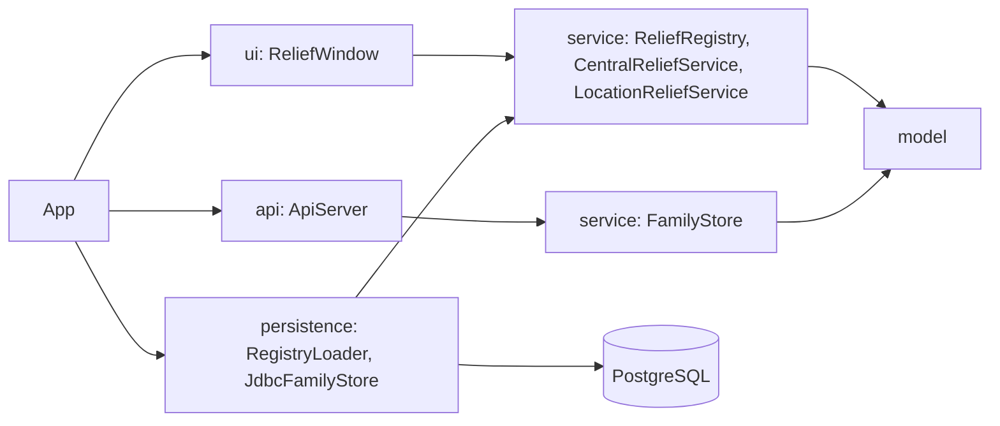
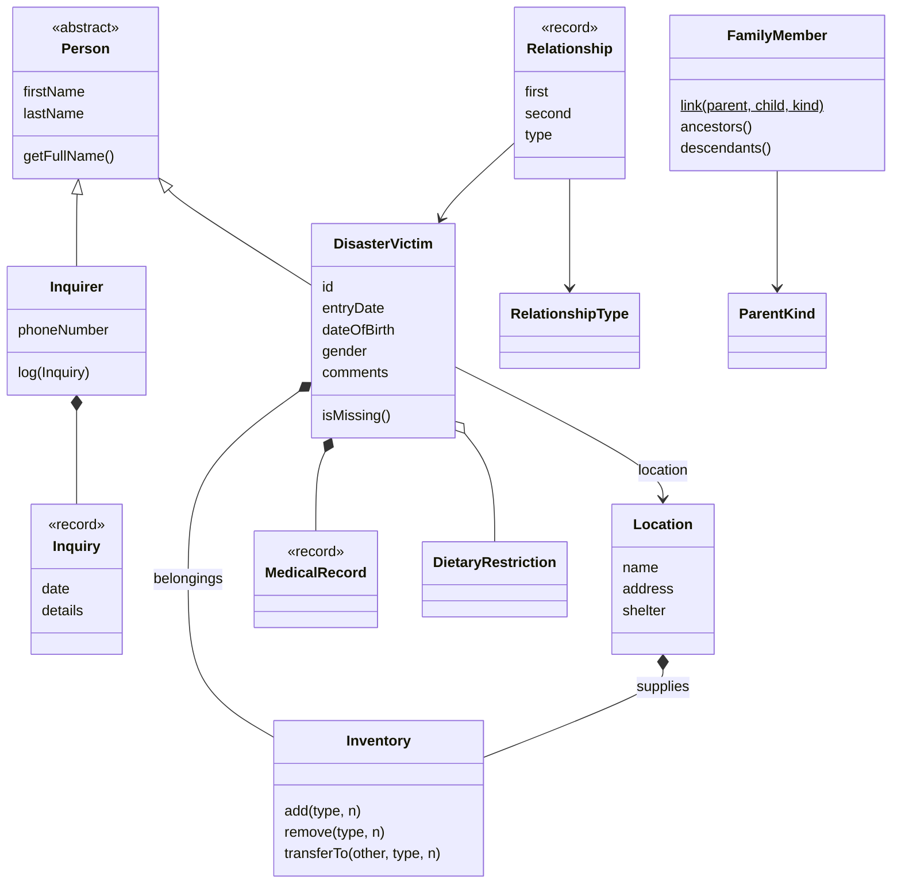

# Architecture

## Layers

Dependencies point inward. `model` imports nothing from the other packages. `service` knows only `model`. `persistence` builds service objects from the database, and `App` is the only class that wires everything together, so the UI and the API never see JDBC.

The desktop app and the API share a database but not memory. The desktop app reads every table once at start into a `ReliefRegistry`. The API reads and writes the family tables on each request.

## Domain model

Some choices worth knowing:

- Each fact has one owner. A victim's location is stored on the victim only, and "who is at this shelter" is a query on the registry, so the two sides cannot disagree. Relationships live in one set in the registry, which makes removing a victim a single `removeIf`.
- `Inventory` holds supply counts for both shelters and victims. Giving supplies is `shelter.transferTo(victim, type, n)`, which checks the shelter's stock before it changes anything.
- Values that never change after creation (`Inquiry`, `MedicalRecord`, `Relationship`) are records, so equality and hashing come for free. `Relationship` stores the smaller id first, which makes (a, b) and (b, a) the same relationship.
- Every rule is checked in the constructor or method that would break it, and a broken rule is an `IllegalArgumentException` with a message a person can read. The UI shows that message as is.
- There is no static state. Tests build a fresh `ReliefRegistry` each time.

`FamilyMember` and `ParentKind` model the family graph used by the API. It is a directed graph without cycles, in which a person can have several parents and ancestors can be shared. `RelationshipType` covers the looser, symmetric relationships the desktop app shows (sibling, friend, couple, and so on).
