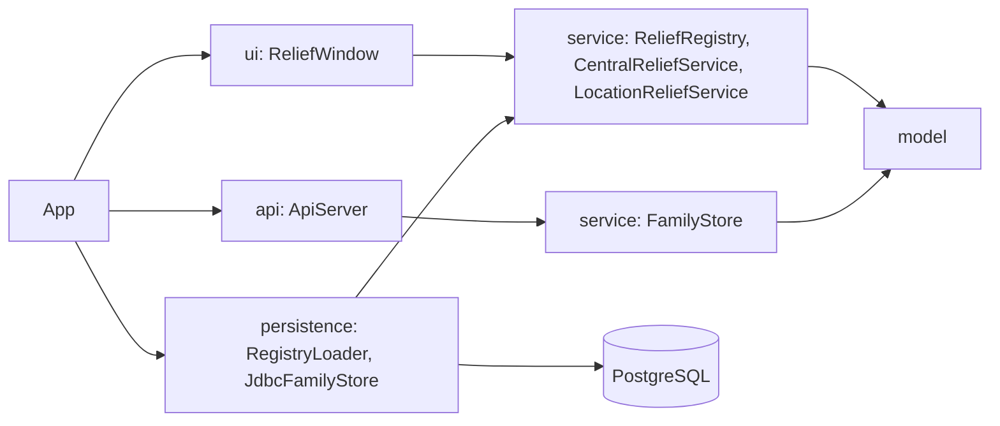
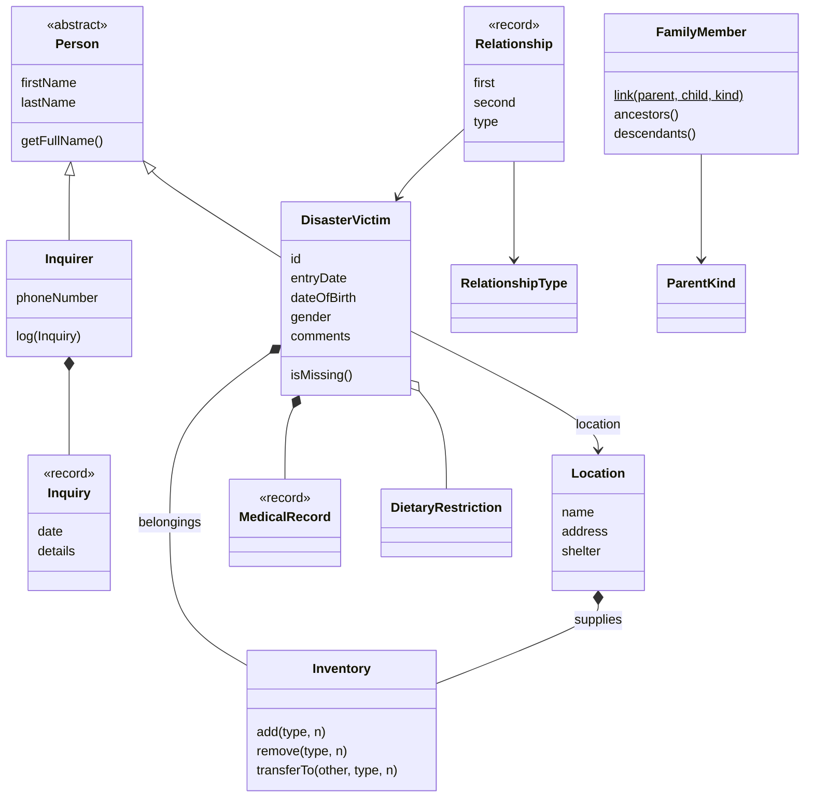
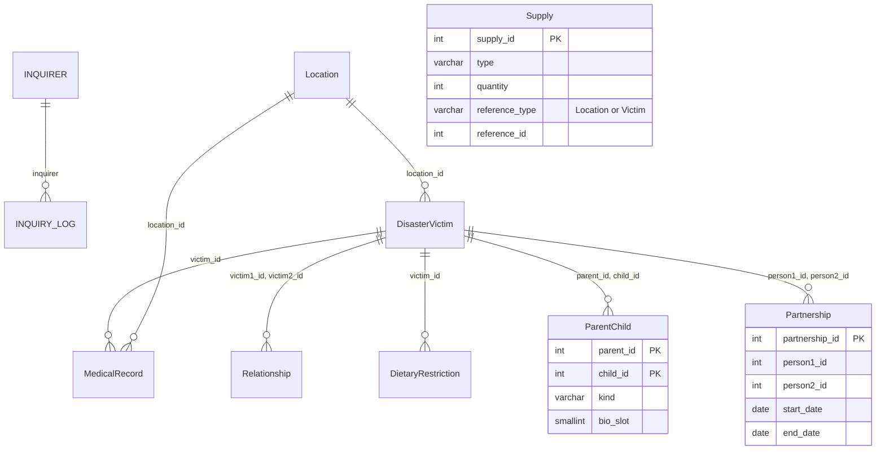

# Architecture

## Layers

Dependencies point inward. `model` imports nothing from the other packages. `service` knows only `model`. `persistence` builds service objects from the database, and `App` is the only class that wires everything together, so the UI and the API never see JDBC.

The desktop app and the API share a database but not memory. The desktop app reads every table once at start into a `ReliefRegistry`. The API reads and writes the family tables on each request.

## Domain model

Some choices worth knowing:

- Each fact has one owner. A victim's location is stored on the victim only, and "who is at this shelter" is a query on the registry, so the two sides cannot disagree. Relationships live in one set in the registry, which makes removing a victim a single `removeIf`.
- `Inventory` holds supply counts for both shelters and victims. Giving supplies is `shelter.transferTo(victim, type, n)`, which checks the shelter's stock before it changes anything.
- Values that never change after creation (`Inquiry`, `MedicalRecord`, `Relationship`) are records, so equality and hashing come for free. `Relationship` stores the smaller id first, which makes (a, b) and (b, a) the same relationship.
- Every rule is checked in the constructor or method that would break it, and a broken rule is an `IllegalArgumentException` with a message a person can read. The UI shows that message as is.
- There is no static state. Tests build a fresh `ReliefRegistry` each time.

`FamilyMember` and `ParentKind` model the family graph used by the API. It is a directed graph without cycles, in which a person can have several parents and ancestors can be shared. `RelationshipType` covers the looser, symmetric relationships the desktop app shows (sibling, friend, couple, and so on).

## Family store

`FamilyStore` is an interface with two implementations:

- `JdbcFamilyStore` runs on the `ParentChild` and `Partnership` tables. The database enforces the rules and the class turns SQL states into messages.
- `InMemoryFamilyStore` keeps `FamilyMember` objects, whose `link` method checks the same rules.

`FamilyStoreContract` is one set of tests that both implementations must pass, so they cannot drift apart. `ApiServer` takes any `FamilyStore`, which lets its tests run over HTTP without a database.

## Database

`Supply.reference_id` points at a location or a victim depending on `reference_type`, so it has no foreign key.

The migrations in `database/migrations` use `IF NOT EXISTS`, `CREATE OR REPLACE` and `DROP ... IF EXISTS` throughout. `migrate.sh` applies all of them every time, in name order, and there is no migration history table. Keep new migrations replayable and additive so the running version keeps working while a new one rolls out.

## Family rules

| Rule | Enforced by |
|---|---|
| No self parent | CHECK `parentchild_no_self` |
| One link per pair, whatever the kind | primary key `(parent_id, child_id)` |
| Both people exist | foreign keys, `ON DELETE CASCADE` |
| Kind is BIOLOGICAL, ADOPTIVE or STEP | CHECK `parentchild_kind_check` |
| At most two biological parents | trigger assigns `bio_slot` 1 or 2; partial unique index on `(child_id, bio_slot)` |
| Nobody is their own ancestor | trigger `parentchild_guard`, under an advisory lock |
| A partnership is stored once per pair and start date | CHECK `person1_id < person2_id`, UNIQUE `(person1_id, person2_id, start_date)` |
| End date not before start date | CHECK `partnership_dates_check` |

### Cycles under concurrency

Two transactions can each add half of a cycle: A becomes parent of B while B becomes parent of A. Under READ COMMITTED each would check, see no cycle and commit.

The trigger takes `pg_advisory_xact_lock` on a fixed key before it checks. The second transaction waits until the first commits, then its check runs with a fresh snapshot, sees the new row and fails with SQL state `FC001`. `JdbcFamilyStoreTest.oppositeHalvesOfACycleCannotBothCommit` runs this race with two connections; it fails if the lock is removed.

The cost is that writes to `ParentChild` run one at a time. Reads are not blocked. If write volume ever matters, lock per connected component or switch to SERIALIZABLE with retries.

### Walking the graph

`JdbcFamilyStore` walks `ParentChild` with a recursive CTE, up through `child_id` to `parent_id` or down the other way. `UNION` drops repeated rows, so an ancestor reached by two routes is expanded once per depth, and the outer query keeps the shortest distance. `maxDepth` caps the walk even if bad data contains a cycle; the store then refuses to build a graph from it.

The primary key serves the downward walk. The index `parentchild_child_idx` serves the upward one.

## Known limits

- The desktop app does not write to the database.
- `JdbcFamilyStore` opens a connection per call; there is no pool.
- The API has no authentication or TLS.
