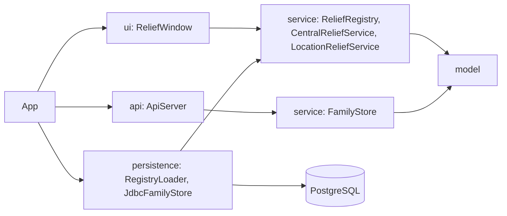

# Architecture

## Layers

Dependencies point inward. `model` imports nothing from the other packages. `service` knows only `model`. `persistence` builds service objects from the database, and `App` is the only class that wires everything together, so the UI and the API never see JDBC.

The desktop app and the API share a database but not memory. The desktop app reads every table once at start into a `ReliefRegistry`. The API reads and writes the family tables on each request.
